<p align="center">
  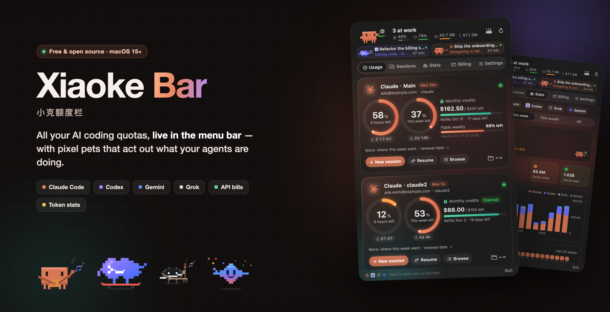
</p>

<p align="center">
  <a href="https://github.com/Zhao73/xiaoke-bar/releases/latest"></a>
  
  
  <a href="LICENSE"></a>
  <a href="https://github.com/Zhao73/xiaoke-bar/stargazers"></a>
</p>

<p align="center">
  <b>English</b> · <a href="README.zh-CN.md">简体中文</a>
</p>

**Xiaoke Bar** lives in your Mac's menu bar and shows, at a glance, how much of every AI coding plan you have left — Claude Code (every account you have), Codex, Gemini and Grok — plus when each limit resets, what your sessions are doing right now, and how many tokens you've actually burned.

And because staring at percentages is boring, every running agent gets a little pixel pet that acts out what it's doing: typing when it edits code, hammering when it builds, sending out helpers when it spawns sub-agents. Click its bubble to jump straight to that session's terminal tab.

It's a native SwiftUI app — no Electron, no account, no server. Everything is read locally and sent only to each vendor's own API.

<p align="center">
  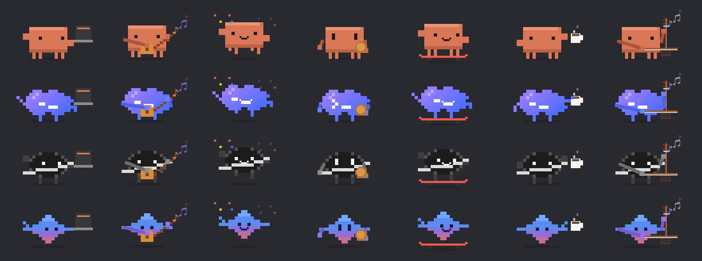
</p>

## Why you might want it

- **You juggle several Claude accounts** (personal + work, or a couple of Max plans). Each one gets its own card: 5-hour window, weekly window, per-model weekly limits, monthly credits and the next renewal date — side by side.
- **You hit the 5-hour limit in the middle of something.** You get a notification at 80 % and 95 %, and a countdown to the reset is always one click away.
- **You run agents in parallel** and lose track of them. The desktop pets float above your windows, show each session's latest message, and take you to the right terminal tab when you click a bubble.
- **You wonder whether your subscription is worth it.** The Billing tab prices your local Claude usage at official API rates, and can track real API spend for Anthropic / OpenAI admin keys, OpenRouter, DeepSeek and OpenAI-compatible relays.

## Features

<table>
<tr>
<td width="50%">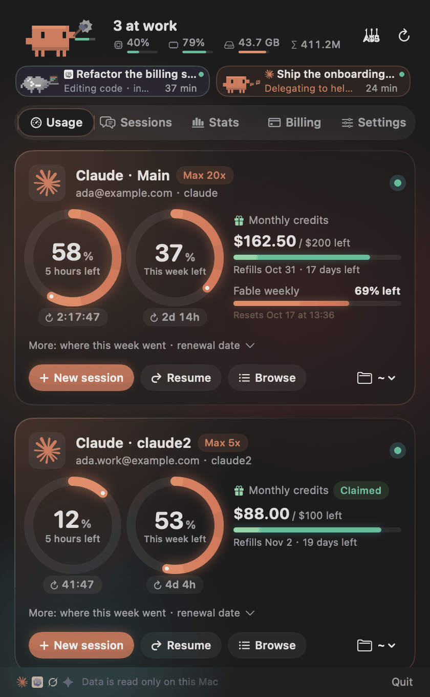</td>
<td width="50%">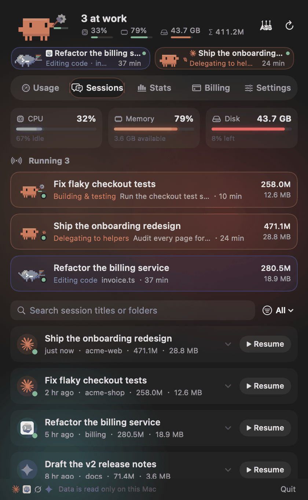</td>
</tr>
<tr>
<td><b>Usage</b> — one card per account. Rings fill to the remaining quota with a live reset countdown; monthly credits show what's left and when they refill. Start a new session, <code>--continue</code> or <code>--resume</code> in any recent folder.</td>
<td><b>Sessions</b> — what's running now (and what each agent is doing), CPU / memory / disk, plus a searchable list of every past session. <i>Resume</i> reopens it with the right account, in the right folder.</td>
</tr>
<tr>
<td>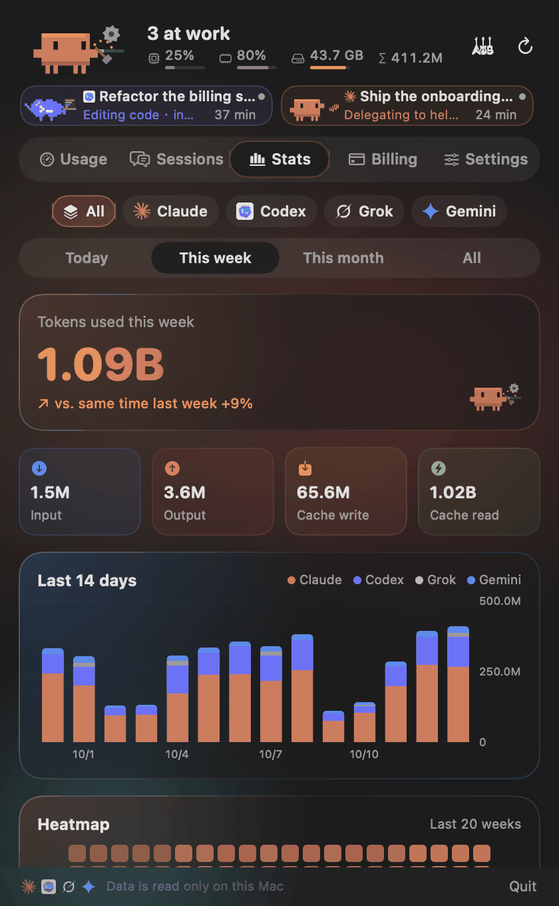</td>
<td>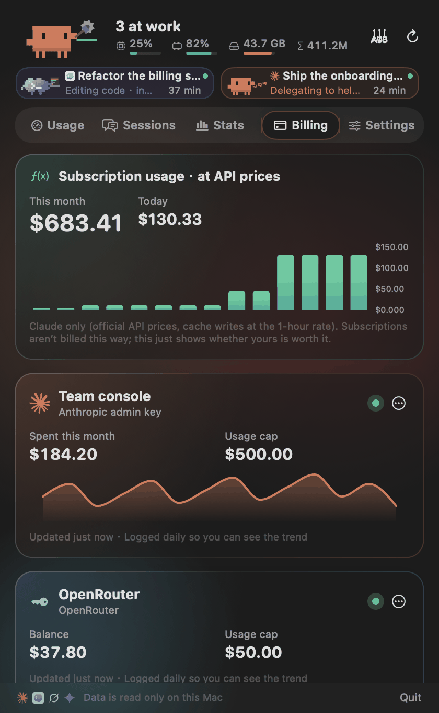</td>
</tr>
<tr>
<td><b>Stats</b> — tokens for today / this week / this month / all time, split by tool, by Claude account and by session. 14- and 30-day bar charts and a 20-week heatmap. Cross-checked day by day against <code>ccusage</code>.</td>
<td><b>Billing</b> — your Claude usage priced at API rates, and real spend for API keys you add (stored in the macOS Keychain), with a daily trend line.</td>
</tr>
</table>

### Supported tools

| Tool | What you see | Where it comes from |
| --- | --- | --- |
| **Claude Code** (every account) | 5-hour and weekly limits, per-model weekly limits, monthly credits, plan, estimated renewal date | The login Claude Code already keeps in your Keychain → Anthropic's usage endpoint |
| **Codex** | Weekly limit and reset, free resets left, extra credits, plan and expiry | `~/.codex/auth.json` → ChatGPT's usage endpoint; falls back to recent session logs offline |
| **Gemini CLI / Antigravity** | Per-model quota buckets and plan | Gemini CLI's local login; Antigravity's local language server while the editor is open |
| **Grok Build** | Login state, tier, real token usage | `~/.grok/` (xAI has no public quota API) |
| **Token stats** | Every session on this Mac | `~/.claude/projects`, `~/.codex/sessions`, `~/.grok/sessions` — scanned incrementally, ~1 min the first time, under a second after that |

Extra Claude accounts are picked up automatically from launcher scripts in `~/.local/bin` that set `CLAUDE_CONFIG_DIR` (e.g. `claude2`). Settings → *Add a Claude account* creates one for you: a separate login, with memory, rules, skills and plugins symlinked to your main `~/.claude`.

### Meet the crew

<p align="center">
  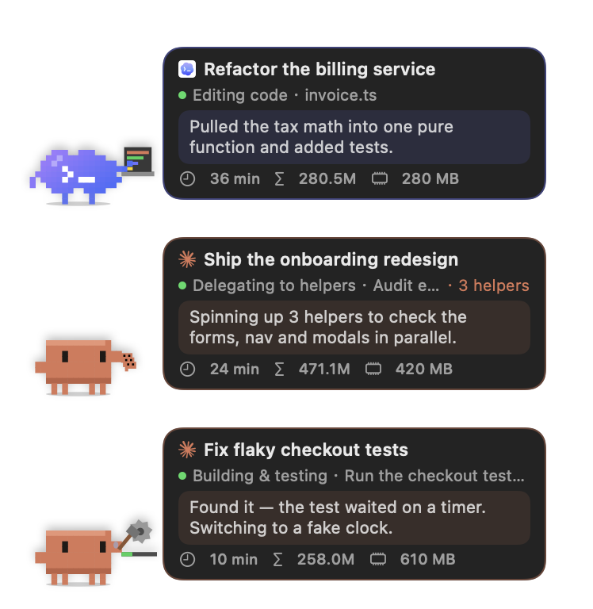
  &nbsp;
  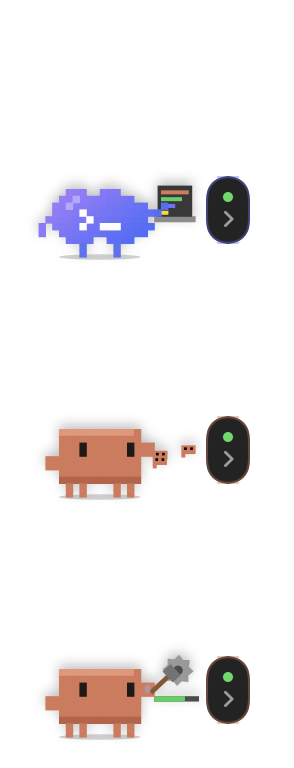
</p>

**Xiaoke** (Claude), **Co** (Codex), **G** (Grok) and **Gem** (Gemini) live in the menu bar, the panel and — if you turn it on — on your desktop.

- One pet per running session. Over 40 animations, matched to what the agent is doing: editing, reading, searching, running commands, taking screenshots, deploying, delegating to helpers…
- Its mouth moves while the AI is talking, and the bubble types out the latest thing it said. Bubbles can be collapsed if they get in the way.
- Right-click a pet to feed it a cookie, pet it, walk the dog, play fetch, nap with the cat.
- Pets have moods: pats, snacks and finished tasks cheer them up; running out of quota makes them sad.
- **Start a band.** 18 public-domain tunes from China, Japan and the West, played on synthesized piano, guitar, bass, drums, flute, violin, music box — and an erhu modelled on real recordings, for *Erquan Yingyue* played by Xiaoke in sunglasses.

<p align="center">
  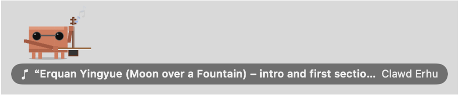
  &nbsp;
  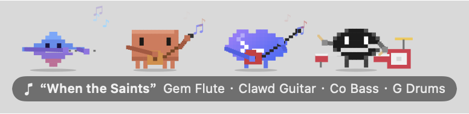
</p>

### Little things

- **Privacy mode** blurs session titles, folder names and AI messages everywhere — handy for screen recordings and screenshots. Emails can be partially masked too.
- English, 简体中文, 繁體中文 and 日本語.
- Light and dark, with an aurora background that shifts with the pets' mood.
- Keyboard: ⌘1–5 switch tabs, ⌘R refresh, ⌘, settings.
- The menu bar item can rotate between quota, CPU, memory, disk and today's tokens.

<p align="center">
  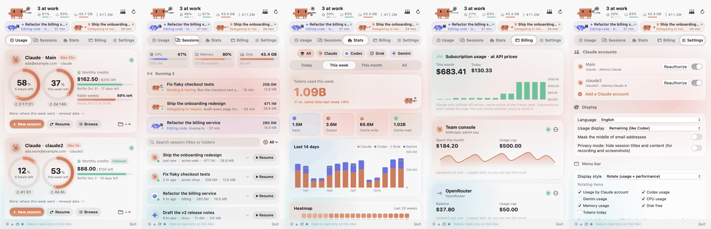
</p>

## Install

1. Download `XiaokeBar.zip` from the [latest release](https://github.com/Zhao73/xiaoke-bar/releases/latest) and unzip it.
2. Move **小克额度栏.app** to `/Applications`.
3. Open it. The app is signed with a Developer ID and notarized by Apple, so it opens like any other app.

Requires macOS 15 or later on Apple silicon (Intel Macs: build from source — untested). You need at least one of Claude Code, Codex, Gemini CLI or Grok Build installed and logged in for there to be something to show.

### Build from source

```bash
git clone https://github.com/Zhao73/xiaoke-bar.git
cd xiaoke-bar
./scripts/build-app.sh --install   # builds dist/小克额度栏.app and copies it to ~/Applications
swift test
```

Only the Xcode command line tools are needed. Other handy commands:

```bash
.build/release/XiaokeBar --selftest                       # print what it can read, no UI
XIAOKE_DEMO=1 .build/release/XiaokeBar --snapshot out/    # render every screen with fake demo data
./scripts/notarize.sh                                     # Developer ID sign + notarize + zip (maintainers)
./scripts/readme-assets/make.sh                           # regenerate the images in this README
python3 scripts/l10n_check.py                             # find untranslated UI strings
```

## iPhone companion

The app on the releases page can also pair with the Xiaoke Bar iPhone app (quota and sessions on the phone, live terminal). That part is not in this repository: building from this source gives you every Mac feature, without iPhone pairing.

## Privacy

- **No accounts, no analytics.** The only server involved is the optional end-to-end encrypted relay used by iPhone pairing in the released app; it only sees ciphertext. The app never stores a password. It reads the credentials that Claude Code, Codex, Gemini CLI and Grok already keep on your Mac and sends them only to each vendor's own API, exactly as those tools do.
- API keys you add for billing are stored in the macOS Keychain.
- Session logs are read locally to count tokens; the index is cached in `~/Library/Application Support/XiaokeBar/`.
- Every screenshot in this README uses built-in demo data (`XIAOKE_DEMO=1`), not anyone's real sessions.

## Project layout

```
Sources/XiaokeBar/
  App/        menu bar item, popover, AppModel (refresh, alerts, stats), self-test and snapshot modes, demo data
  Core/       models, shell / Keychain / network helpers, terminal launcher, translations
  Providers/  Claude, Codex, Grok, Gemini and API billing
  Stats/      incremental session log scanner, API pricing
  UI/         the five tabs and animation components (Core Animation for anything that loops)
  Pet/        pixel pets, two drawing back-ends, instrument synths, song book, desktop pets
```

Design notes live in [DESIGN-NOTES.md](DESIGN-NOTES.md) (in Chinese).

## Contributing

Issues and pull requests are welcome — new providers, new pet animations, translations, bug reports with `--selftest` output (please scrub emails first). Run `swift test` and `python3 scripts/l10n_check.py` before opening a PR.

If Xiaoke Bar saves you from one surprise rate limit, a ⭐ helps other people find it.

## Disclaimer

Xiaoke Bar is an independent, unofficial project. It is not affiliated with, endorsed by or sponsored by Anthropic, OpenAI, Google or xAI. Claude, Codex, ChatGPT, Gemini, Antigravity and Grok are trademarks of their respective owners; their logos are shown only to identify each service. Usage endpoints used by the app are not public APIs and may change at any time.

## Credits

Service logos come from [LobeHub Icons](https://github.com/lobehub/lobe-icons) (MIT). Songs in the band are public-domain melodies, arranged and synthesized in code — no audio samples are bundled.

## License

Copyright (C) 2026 Zhao73. Released under the [GNU GPL v3.0](LICENSE). You may use, change and redistribute it, but anything you distribute that is built from this code must also be released as source under the GPL.
