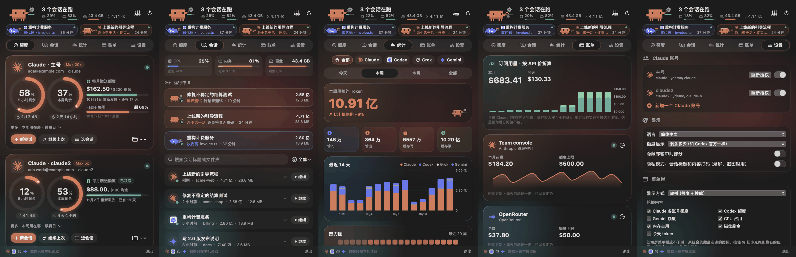

<p align="center">
  
</p>

<p align="center">
  <a href="https://github.com/Zhao73/xiaoke-bar/releases/latest"></a>
  
  
  <a href="LICENSE"></a>
  <a href="https://github.com/Zhao73/xiaoke-bar/stargazers"></a>
</p>

<p align="center">
  <a href="README.md">English</a> · <b>简体中文</b>
</p>

**小克额度栏**常驻在 Mac 右上角的菜单栏。点一下就能看到所有 AI 编程账号还剩多少额度：Claude Code（你有几个账号就显示几个）、Codex、Gemini、Grok。每个额度什么时候重置、现在有哪些会话在跑、到底用掉了多少 Token，也都在这里。

光看百分比太无聊，所以每个在跑的会话都配了一只像素宠物，按 AI 正在做的事换动作：改代码时敲键盘，编译时抡锤子，派子代理时喊来几个小弟。点它的气泡就跳到那个会话所在的终端标签页。

原生 SwiftUI 应用：不是 Electron，不用注册，没有服务器。所有数据都在本机读取，只发给各家自己的官方接口。

<p align="center">
  
</p>

## 适合谁

- **同时有好几个 Claude 账号**（个人 + 工作，或者两个 Max）。每个账号一张卡片，5 小时额度、本周额度、按模型的周额度、每月赠送额度、下次续费日，并排看。
- **经常干到一半撞上 5 小时上限。** 用到 80% 和 95% 时发系统通知，离重置还有多久随时看得到。
- **同时开好几个 Agent，转头就忘了谁在干嘛。** 桌面宠物浮在窗口上方，气泡里显示每个会话最新说的话，点一下切到对应终端。
- **想知道订阅到底值不值。** 账单页把本机 Claude 用量按官方 API 价折算；也能接 Anthropic / OpenAI 管理密钥、OpenRouter、DeepSeek 和 OpenAI 兼容中转站，看真实花费。

## 功能

<table>
<tr>
<td width="50%"></td>
<td width="50%"></td>
</tr>
<tr>
<td><b>额度</b>：每个账号一张卡。圆环显示剩余额度并实时倒计时到重置；每月赠送额度显示剩多少、哪天重新发放。可以在最近用过的文件夹里一键新会话、<code>--continue</code> 或 <code>--resume</code>。</td>
<td><b>会话</b>：正在跑的会话（以及每个 Agent 在干什么）、CPU / 内存 / 磁盘，加上所有历史会话的搜索列表。点「继续」会用会话所属的账号、在原来的文件夹里恢复。</td>
</tr>
<tr>
<td></td>
<td></td>
</tr>
<tr>
<td><b>统计</b>：今天 / 本周 / 本月 / 全部的 Token，按工具、按 Claude 账号、按会话拆开。14 天和 30 天柱状图、20 周热力图。和 <code>ccusage</code> 逐日对过账，数字一致。</td>
<td><b>账单</b>：Claude 用量按 API 价折算；你添加的 API Key（存在系统钥匙串里）显示真实花费和每日走势。</td>
</tr>
</table>

### 支持哪些工具

| 工具 | 显示什么 | 数据从哪来 |
| --- | --- | --- |
| **Claude Code**（每个账号） | 5 小时额度、本周额度、按模型的周额度、每月赠送额度、套餐、推算的续费日 | Claude Code 自己存在钥匙串里的登录凭证 → Anthropic 官方用量接口 |
| **Codex** | 本周额度和重置时间、剩余免费重置次数、额外点数、套餐和到期日 | `~/.codex/auth.json` → ChatGPT 官方用量接口；连不上时读最近的会话日志 |
| **Gemini CLI / Antigravity** | 按模型的额度和套餐 | Gemini CLI 的本机登录；Antigravity 编辑器开着时读它本机语言服务器 |
| **Grok Build** | 登录状态、会员档位、真实 Token 用量 | `~/.grok/`（xAI 没有公开额度接口） |
| **Token 统计** | 本机所有会话 | `~/.claude/projects`、`~/.codex/sessions`、`~/.grok/sessions`，增量扫描：第一次约 1 分钟，之后不到 1 秒 |

额外的 Claude 账号会自动识别：`~/.local/bin` 里设置了 `CLAUDE_CONFIG_DIR` 的启动脚本（比如 `claude2`）。设置页「新增一个 Claude 账号」会帮你建一个：登录信息独立，记忆、规则、skills、插件用软链接和主号 `~/.claude` 共用。

### 小克和伙伴们

<p align="center">
  
  &nbsp;
  
</p>

**小克**（Claude）、**小 Co**（Codex）、**小 G**（Grok）、**小 Gem**（Gemini）住在菜单栏、面板里，打开设置后也会出现在桌面上。

- 每个在跑的会话一只宠物。40 多个动作，按 AI 正在做的事切换：改代码、看文件、搜索、跑命令、截图、部署、派小弟……
- AI 说话时宠物张嘴，气泡里逐字打出它最新说的话。气泡挡事时可以折叠起来。
- 右键某一只：喂饼干、摸头、遛狗、扔球、陪猫睡午觉。
- 宠物有心情：摸头、喂零食、任务完成会开心，额度快用完会难过。
- **组乐队。** 18 首公有领域曲子（中国、日本、欧美），用合成的钢琴、吉他、贝斯、鼓、长笛、小提琴、八音盒演奏；二胡按真实录音建模，《二泉映月》由戴墨镜的小克来拉。

<p align="center">
  
  &nbsp;
  
</p>

### 小细节

- **隐私模式**：会话标题、文件夹名、AI 说的话全部打码，录屏和截图时用。邮箱也可以只显示首尾。
- 界面支持简体中文、繁體中文、English、日本語。
- 深色 / 浅色两套，背景极光随宠物心情变色。
- 快捷键：⌘1–5 切页、⌘R 刷新、⌘, 设置。
- 菜单栏图标可以轮播：额度、CPU、内存、磁盘、今天的 Token。

<p align="center">
  
</p>

## 安装

1. 从 [最新版本](https://github.com/Zhao73/xiaoke-bar/releases/latest) 下载 `XiaokeBar.zip` 并解压。
2. 把 **小克额度栏.app** 拖到「应用程序」文件夹。
3. 双击打开。App 已用开发者证书签名并通过 Apple 公证，和普通软件一样直接打开。

需要 macOS 15 及以上、Apple 芯片的 Mac（Intel 机型可以从源码编译，未测试）。另外至少要装好并登录 Claude Code、Codex、Gemini CLI、Grok Build 其中之一，才有东西可显示。

### 从源码编译

```bash
git clone https://github.com/Zhao73/xiaoke-bar.git
cd xiaoke-bar
./scripts/build-app.sh --install   # 打包到 dist/小克额度栏.app 并复制到 ~/Applications
swift test
```

只需要 Xcode 命令行工具。其他常用命令：

```bash
.build/release/XiaokeBar --selftest                       # 不开界面，打印能读到的额度和统计
XIAOKE_DEMO=1 .build/release/XiaokeBar --snapshot out/    # 用内置假数据把每个页面渲染成图片
./scripts/notarize.sh                                     # 开发者证书签名 + 公证 + 打包（维护者用）
./scripts/readme-assets/make.sh                           # 重新生成本 README 里的图片
python3 scripts/l10n_check.py                             # 检查漏翻的界面文字
```

## iPhone 配合

发布页下载的 App 还能和小克额度栏 iPhone App 配对（手机上看额度、会话和实时终端）。这部分源码不在本仓库：用这里的源码自己编译，可以得到全部 Mac 功能，但没有 iPhone 配对。

## 隐私

- **不用注册、不做统计。** 唯一可能用到的服务器是发布版 iPhone 配对用的端到端加密中转，它只能看到密文。App 不保存任何密码，只读取 Claude Code、Codex、Gemini CLI、Grok 已经存在你 Mac 上的登录凭证，并且只发给它们各自的官方接口，和这些工具自己做的事一样。
- 为账单添加的 API Key 存在系统钥匙串里。
- 会话记录只在本机读取来统计 Token，索引缓存在 `~/Library/Application Support/XiaokeBar/`。
- 本 README 里的所有截图都是内置演示数据（`XIAOKE_DEMO=1`），不是任何人的真实会话。

## 代码结构

```
Sources/XiaokeBar/
  App/        菜单栏图标、弹出面板、AppModel（刷新、提醒、统计）、自检和截图模式、演示数据
  Core/       数据模型、命令行 / 钥匙串 / 网络工具、终端启动器、翻译表
  Providers/  Claude、Codex、Grok、Gemini 和 API 账单
  Stats/      会话记录增量扫描、API 价格
  UI/         五个页面和动画组件（循环动画一律用 Core Animation）
  Pet/        像素宠物、两种绘制后端、乐器合成、曲库、桌面宠物
```

设计笔记见 [DESIGN-NOTES.md](DESIGN-NOTES.md)。

## 参与

欢迎提 Issue 和 PR：新的工具支持、新的宠物动作、翻译、附带 `--selftest` 输出的 bug 报告（发之前请先把邮箱抹掉）。提 PR 前请跑一下 `swift test` 和 `python3 scripts/l10n_check.py`。

如果它帮你躲过了一次突然的限流，点个 ⭐ 能让更多人看到它。

## 免责声明

小克额度栏是独立的非官方项目，与 Anthropic、OpenAI、Google、xAI 没有任何关联，也未获得它们的认可或赞助。Claude、Codex、ChatGPT、Gemini、Antigravity、Grok 是各自所有者的商标，Logo 仅用于标识对应服务。App 用到的用量接口不是公开 API，随时可能变化。

## 致谢

各家 Logo 来自 [LobeHub Icons](https://github.com/lobehub/lobe-icons)（MIT 许可）。乐队曲目都是公有领域旋律，由代码编曲和合成，不附带任何音频采样。

## 许可

Copyright (C) 2026 Zhao73。以 [GNU GPL v3.0](LICENSE) 发布。可以自由使用、修改和再分发，但基于这份代码分发的软件也必须以 GPL 公开源码。
